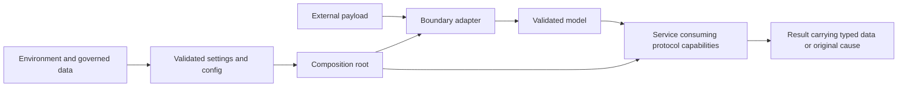

<!-- AUTO-GENERATED FILE — regenerate through `make gen` from the workspace root. -->
<!-- Source of truth: `<workspace-root>/docs/guides/using-pydantic.md`; adjust that workspace source, never this member projection. -->

# flext-ldap - Using Pydantic in FLEXT

> Project profile: `flext-ldap`

<!-- TOC START -->

- [Authority](#authority)
- [Where each Pydantic concern lives](#where-each-pydantic-concern-lives)
- [Domain ownership and composition](#domain-ownership-and-composition)
- [Model declarations and native validation](#model-declarations-and-native-validation)
- [MRO, nesting and generic specialization](#mro-nesting-and-generic-specialization)
- [Library boundaries](#library-boundaries)
- [Serialization and data safety](#serialization-and-data-safety)
- [What consumers never do](#what-consumers-never-do)
- [Enforcement](#enforcement)
- [Static and runtime typing evidence](#static-and-runtime-typing-evidence)
  - [Analyzer rule review](#analyzer-rule-review)
  - [Analyzer declaration snapshot — 2026-10-28](#analyzer-declaration-snapshot-2026-10-28)
- [Source-derived protocol contracts](#source-derived-protocol-contracts)
  - [Dependency documentation references](#dependency-documentation-references)

<!-- TOC END -->

## Authority

The canonical, source-cited law is the `pydantic-development` skill
(`~/agents/skills/technology/pydantic-development/`, distributed to every agent home)
and the `rules/python/pydantic.md` rule. This guide maps that law onto the FLEXT
facades. The declared dependency floor governs which APIs a project may use;
the selected lock and the runtime actually loaded must agree with that contract.
Do not infer a fleet-wide capability from one installed environment. Member locks
and the workspace lock that composes them follow
(ADR-030).

Two 2026-10-25 operator rulings bind every FLEXT model (root `AGENTS.md`
"Pydantic law"; ADR-028 Decisions 14 and 19):

- models import `u` only from the upstream FLEXT project or, in very restricted
  cases, from a private `_utilities` class of their own namespace; arbitrary
  business methods belong outside models, while native validators, serializers
  and computed fields remain model declarations. The Pydantic surface they need
  lives in `_models/pydantic.py`
  (tracker memory `operator-ruling-2026-10-25-models-u-imports-pydantic-home`);
- entity equality is Pydantic value equality with explicit identity by id
  (tracker memory `operator-ruling-2026-10-25-entity-equality-pydantic-way`; see
  Domain models).

## Where each Pydantic concern lives

| Concern | FLEXT owner | Consumer form |
| --- | --- | --- |
| Model configuration | Existing `m.*` presets in Core | Inherit the preset matching the contract; do not copy its `ConfigDict` |
| Reusable constrained types | `t` aliases over native annotations | `field: t.NonEmptyStr`; metadata and hooks come from their existing owners |
| Closed domains | `StrEnum` classes in `c` | Declare the owning enum directly; a union tag uses its declared subset |
| Dependency-typed fields | Minimal runtime-checkable capabilities in `p` | Use the existing `t.Port` contract and exclude the dependency from serialization |
| Payload and service protocols | Source-derived projection owner under ADR-018 | Generate from actual declarations; never hand-mirror models |
| Non-model validation | Existing adapter owner, with its typed contracts | Reuse an adapter for the actual scalar, collection or union contract |
| Outcomes | `r` / `p.Result[T]` | Convert `ValidationError` once at the declared ingress boundary; preserve its cause |
| Runtime knobs | `settings.<Namespace>.*` (pydantic-settings) | read through the singleton, never `os.environ` |
| Static rules | `config.<Namespace>.*` from `config/*.yaml` | read through the singleton |

Only flext-core imports `pydantic`, `pydantic_settings` or `pydantic_core`.

The operator's 2026-10-28 declaration policy uses the enum type for its full
domain. `Literal` expresses a proper subset or a discriminator; enumerating
every member again duplicates the owner. Strict Python constructors receive
enum members and the appropriate typed nested values. JSON ingress uses the
existing JSON validation boundary once. Do not weaken strictness or serialize
Python input to JSON to make validation accept it.

The latest operator revision requires `use_enum_values=False` in governed model
presets, including `ContractModel`, superseding the previous `True`/primitive-read
target. These settings have separate responsibilities: `strict=True` controls
the accepted Python input; `use_enum_values=False` preserves the enum member after
validation. It does not make an otherwise permissive preset strict. Generated
protocols retain the actual enum type, with no setter for a frozen field.
Defaults and factories must validate through their preset owner. Keep validated
models and enum members by reference between internal boundaries; serialize their
values only at the outward format boundary. Neither a dump nor a raw mapping is
a substitute for an already valid model. The revised migration and runtime
acceptance remain pending. The precise
owners are ADR-005
and ADR-028 Decision 14.

Compose native models, specialized generics and existing presets before adding
validation machinery. Reuse the existing adapter, `InstanceOf` and
`GetPydanticSchema` owners where their contracts apply. The existing `t.Port`
checks runtime protocol presence; it does not validate signatures. Retain static
protocol checks and real consumer evidence rather than duplicate local narrowing.
`t.Port` is a FLEXT DI annotation built on native hooks and excludes its runtime
dependency from JSON Schema. It must not replace a serializable payload's
validation: a payload projected to `p` delegates its original concrete annotation
through `GetPydanticSchema`, preserving validators, serializers and JSON Schema.
An unresolved port type parameter fails instead of selecting `any_schema`.
See ADR-019 for DI
and ADR-018
for payload projection.
Railway callbacks preserve original exceptions; only the declared error boundary
converts a validation failure into a result.

Research starts with the official
[complete Pydantic documentation](https://pydantic.dev/docs/validation/latest/llms-full.txt).
Its `latest` URL is a reference index, not proof that a feature exists in the
project's locked runtime. Check the declared floor and selected lock before using
an API. Upstream references: [standard types](https://docs.pydantic.dev/latest/api/standard_library_types/),
[custom types](https://docs.pydantic.dev/latest/concepts/types/) and
[adapter reuse](https://docs.pydantic.dev/latest/concepts/performance/).

## Domain ownership and composition

Choose an owner by meaning and change authority, not by the Python value's shape:

| Question | Owner and boundary |
| --- | --- |
| Is this a closed vocabulary or invariant? | `c` owns the enum or invariant once; configurable catalogs are not constant tables |
| Is this a reviewed rule or catalog entry? | Governed data is loaded into frozen typed `config`; consumers do not mutate it |
| Can an operator vary it by deployment or process? | The owning `settings` source validates it; services do not reread the environment |
| Is this a reusable type expression? | `t` names the existing constraint or specialization without copying data |
| What capability does this consumer require? | `p` declares that capability independently of the adapter implementing it |
| What data and invariants cross this boundary? | `m` declares the payload and native validation once |
| What calculation or external effect must happen? | `u` or the service owns the behavior, using injected validated inputs |

The family declaration order is `c`, `t`, `p`, `m`, `u`. Runtime imports of later
families use earlier owners; an invariant cannot depend back on the model facade
that is still being assembled. The narrow model/helper exceptions are governed
by ADR-028 Decision 19, not permission for a general `m`/`u` import cycle.

A package adds only its own namespace. An API-owned payload remains under its
API namespace when inherited by another package's model facade; it does not
become a Web-owned payload through renaming or composing the API namespace as
the Web namespace's base. A consuming domain declares the capability it needs,
and its adapter translates a foreign payload once when the meanings differ.
Do not translate an already matching model into another dict-shaped DTO merely
because the call crosses a package boundary.

`api.py` elects concrete adapters and constructs port-bearing services. It reads
the validated settings/config owners and passes the needed values or contracts
to those collaborators. Leaf models never acquire runtime knobs, open files,
resolve services or read globals to discover dependencies. The port-free
singleton and bootstrap exceptions remain owned by ADR-019; this guide does not
turn the service container into a protocol resolver.

## Model declarations and native validation

Start with the existing preset and the smallest consumed contract. Frozen models
represent read-only state; managed models validate supported assignment; strict
contracts reject inappropriate Python inputs. Preserve the declared extra-field
policy: an external subset contract may intentionally ignore provider additions,
but that does not authorize dropping invalid declared fields or accepting extras
at an unrelated domain boundary.

Use native field constraints before custom validators. Reuse constrained `t`
aliases only when the same semantic type is consumed; do not create an alias,
wrapper model or `Field` solely to repeat an existing annotation. A required
nullable field is different from a field with a default of `None`.

Keep constraints in `Annotated`; place constructor-relevant defaults, factories
and aliases in the assignment form recognized by the selected checkers. Preserve
validation and serialization aliases separately. Avoid `Field(...)` ellipsis
when an ordinary required annotation states the contract clearly. Factories
that consume validated earlier fields depend on field order and need direct
positive and failure evidence.

Native `m.field_validator`, `m.model_validator` and `m.computed_field` are selected
through Core's declared facade. Use an after-validator for an invariant over
already typed data. Before/wrap/plain validators are reserved for a demonstrated
boundary requirement; they must not swallow errors, accept invalid data, mutate
another union branch's input or retry a failed parser. After model validators
return the instance and should be pure and idempotent: nested/generic validation
can invoke them more than once. Computed fields derive declared output, not I/O.
See [validators at the declared Pydantic baseline](https://github.com/pydantic/pydantic/blob/v2.14.1/docs/concepts/validators.md).

Use `RootModel` only where a single-root shape is the real external contract;
use the existing adapter for a non-model scalar, collection or union rather than
adding a ceremonial model. Special serializers, validation context and callable
discriminators require an actual consumer and a verified facade export. Schema
hooks extend the native schema for that contract, never create another registry.

`validate_assignment` does not observe arbitrary mutation inside a contained list
or mapping. Likewise, `frozen=True` prevents field replacement rather than making
every nested object immutable. Choose immutable members or an explicit validated
state transition where the domain requires it. `model_validate(existing)` is not
a promise to revalidate an instance: the preset's `revalidate_instances` policy
and mutation contract determine that trust boundary.

## MRO, nesting and generic specialization

MRO composes capability namespaces and reusable declarations; it does not merge
bounded contexts or select configuration/settings values by accident. Generated
facade roots compose the upstream same-letter facade and their own family
holders. A facade is not a Pydantic payload and never inherits a model preset.

Check these three mechanisms independently:

1. Python C3 selects methods and inherited attributes; cooperative hooks call
   `super()` according to their declared contract.
2. Pydantic constructs effective fields, validators, serializers and model config.
   Its multiple-base config composition is not inferred from Python C3.
3. The generator discovers source owners and publishes their facades/lazy exports.
   It must preserve the first two mechanisms rather than approximate their shape.

Prefer one coherent preset chain over conflicting config-bearing bases. Inspect
the effective public `model_config`, `model_fields`, schemas and validation in
both base orders when multiple inheritance is intentional. Entity equality uses
Pydantic value equality; compare identity explicitly by id, and do not assume
that a frozen model is hashable when its fields are not.

Specialize generic models and ports explicitly, preserving bounds, defaults and
constraints. An unbound port cannot accept arbitrary objects. A read-only
protocol property and a writable attribute have different variance contracts;
generation preserves them together with specialization and overloads.

Nested models retain their owning domain. A local model is not automatically
invalid: ADR-018 requires retaining its runtime class and closure while deriving
a deterministic lexical protocol identity. Do not hoist it generically or call
`model_rebuild` to hide an unresolved declaration. Repair the actual dependency
or export, and prove a fresh public import. The enclosing family class is not
bound while its body executes, so a self-qualified sibling reference needs its
real declaring owner, not a fabricated namespace.

## Library boundaries

Structured external payloads enter through their owning adapter as the existing
`m` contract; non-model values use the existing typed adapter. Internal calls pass
those validated objects by reference. The real external format determines the
native validation mode, not which mode happens to make a failing value pass:

- JSON: `Model.model_validate_json(raw)`.
- YAML/TOML: use the existing typed source loader and its declared validation
  path. The boundary owns sequence, enum and scalar decoding; a leaf must not
  add casts, recursive type checks or a JSON detour to make its input pass.
- pydantic-settings custom sources return the mapping its `_read_file` contract
  requires; the settings model validates it.
- structlog processors receive a mapping built from the validated record in one place.

The selected YAML/TOML boundary is `u.Cli.config_decode(parsed, Contract,
source_path=path)`, after the existing parser has captured the document. Fields
whose source grammar differs from their Python contract declare
`t.DocumentInput[...]`: the current implementation covers enum tokens and
document arrays for tuple contracts. It delegates membership, item types and
tuple arity to the original Pydantic schema. Ordinary Python construction does
not select this decoding mode. An unsupported annotation is an error; this is
not a general coercion layer. Operational metadata belongs to the entry owner,
separately from the parsed document. The optional `metadata=` argument carries
an already validated model through the typed validation context. For Rope
catalogs that model is `m.Infra.RopeContractOrigin`; the captured document cannot
elect or replace its operational owner root.

This boundary is under native qualification. Its presence in source does not
establish that the catalog, negative cases or full workspace gates have passed.
Validation context is Pydantic's explicit mechanism for carrying ingress
information through nested validation; it does not authorize consumers to
select a different domain policy. See the
[official validation-context reference](https://pydantic.dev/docs/validation/latest/concepts/validators/#validation-context).

For services, structural request annotations and concrete model metadata have
different jobs: `@h.handler(command=m.Namespace.Request)` retains the actual
parser/schema owner while the operation consumes its generated protocol. DI
ports use `t.Port[p.X]` and are excluded from serialization and JSON Schema;
serializable payload projection delegates the original schema through
`GetPydanticSchema`. Presence-only runtime protocol checks cannot replace payload
validation or static signature compatibility.

At the ingress that owns domain validation, convert `ValidationError` once to the
declared Result with its native error information and cause. A programming
`TypeError`, I/O failure or unrelated exception is not a malformed payload to
normalize. Railway callbacks do not authorize another catch/default layer.

## Serialization and data safety

`model_dump()` in Python mode retains native enum members under the False policy;
`model_dump(mode="json")` produces JSON-compatible data and `model_dump_json()`
emits JSON. Use the mode required by the outward adapter, preserving aliases and
omission rules. Do not replace nested serialization with `dict(model)` or a
handwritten recursive walk. See [native serialization](https://github.com/pydantic/pydantic/blob/v2.14.1/docs/concepts/serialization.md).

Keep monetary precision in its declared decimal contract and validate its bounds;
timestamps follow the domain's timezone policy, using aware UTC where the Core
identity contract requires it. Do not normalize every datetime or string merely
because a validator can. Secret types, error-input hiding and redaction protect
their respective boundaries; they do not authorize dumping credentials into
logs or generated documentation. Preserve declared-base serialization of subclass
fields; duck-typed serialization requires an explicitly consumed output contract
so a subclass cannot leak extra secrets silently.

For performance, reuse the adapter/compiled contract at its existing owner and
profile the actual ingress, nested validation and serialization path. Do not
trade precise models for untyped mappings, add a parallel schema cache, or enable
error omission, unvalidated construction or early error truncation to improve a
benchmark. Faster output must retain the same accepted values and failures.

## What consumers never do

Re-validate a model they already received, `isinstance`/`cast` owned data, convert
between dict and model by hand, compare closed domains with string literals, hold a
second model for a shape an existing model already expresses, or call
`model_rebuild`, `model_construct` or `model_copy(update=...)` on validated data.

## Enforcement

Infra's existing typed rule catalogs own detection and migration. Python semantic
refactors use the native Rope workspace/candidate/publisher; native ast-grep
catalogs retain their declared independent mechanical and verification roles.
Neither role permits another Python parser or a handwritten fleet rewrite.
The presence of a rule does not prove that every forbidden form is covered:
retain positive, negative and fixed-point fixtures and real consumer evidence.
`make mod` owns migration and `make check` owns residual findings. Tests exercise
the public facades without mocks, private access or implementation-shaped claims.

## Static and runtime typing evidence

The approved investigation is `flext-itpd1.13.11`; analyzer environment ownership
is ADR-003, Decision 5.
The canonical `pydantic-development` procedure owns the diagnosis sequence.
Keep runtime validation and static constructor checking distinct: typed
constructors remain enabled, and external data enters through public validation.

Compare the real public facade with the upstream declaration before calling a
diagnostic a false positive. Record the checker version, loaded configuration,
resolved imports, inferred type and runtime result. Cover inherited and nested
models, generic specialization, defaults, aliases, validators, computed fields
and settings. A descriptor returning the original callable at runtime does not,
by itself, prove that a checker recognizes its field-specifier identity.

Pydantic documents that static constructor synthesis does not interpret
`default`, `default_factory` and `alias` inside `Annotated`. Keep constraints as
metadata and expose constructor-relevant declarations in a statically
recognized form, preserving runtime behavior. Multiple-base configuration
composition also needs observed runtime evidence; ordinary Python MRO is not a
substitute for inspecting the effective model configuration.

Lazy loading a module and deferring its model schemas are different contracts.
ADR-028 Decision 14 requires complete declarations when the module is imported;
the current Core `defer_build=True` setting does not satisfy that target. Repair
and fresh-import validation remain pending; a gate that builds the schema later
does not prove import-time completeness.

References: [Pydantic fields](https://docs.pydantic.dev/latest/concepts/fields/),
[configuration inheritance](https://docs.pydantic.dev/latest/concepts/config/),
and [dataclass transforms](https://typing.python.org/en/latest/spec/dataclasses.html).

### Analyzer rule review

The effective policy is read from Infra's native tooling declarations and the
selected checker's own strict-mode defaults. The following review groups the
diagnostics relevant to this investigation; it is not another configuration
catalog. No row authorizes a severity change.

| Rule family | What it establishes | Required diagnosis and disposition |
| --- | --- | --- |
| Missing imports and module sources | The analyzer can resolve a declaration | Verify interpreter, environment parent, editable origins and execution-environment order before investigating MRO |
| Missing third-party stubs | Availability of an external typing contract | Preserve the existing approved policy; source inference does not make every external API precise |
| Unknown types and untyped bases/decorators | Type information survived the boundary | Follow the first unknown symbol through its declaring export; retaining an overload at runtime does not prove static field/decorator identity |
| Constructor calls and argument types | Requiredness, aliases and declared input types | Compare required/default/factory/alias forms with actual validation; preserve typed constructors and public field semantics |
| Assignment, generic arguments and overrides | Substitution and mutability contracts | Inspect inherited specialization, variance and effective model configuration; a successful coercion is not proof of substitutability |
| Optional and unbound access | A value is present before use | Prove the public invariant and narrow at its owner; do not silence these checks because a model validates other fields |
| Unnecessary operations and unused declarations | Reachability and redundant/dead code | Inspect the inferred type first; fix lost precision before interpreting a cascade as redundant code |
| Mypy plugin diagnostics | Pydantic-specific field and model semantics | Keep the plugin and current two-code exception; assess each diagnostic against the native model and the public facade |

Relevant native options include mypy's import-following, package-base, re-export,
untyped-body, equality, reachability and unused-ignore checks, and Pyright's
strict inference and `reportUnknown*`, constructor, override and decorator
diagnostics. Their values remain owned by the selected configuration, not by
this review table. Lowering strictness can remove evidence without restoring
inference; it is not a causal repair.

### Analyzer declaration snapshot — 2026-10-28

This snapshot records the inspected declarations, not a second policy owner or
proof of the configuration loaded by a running checker. The writable owners are
native tooling settings,
the Mypy projection,
and the Pyright projection.
Project overlays, inline directives, command arguments and editor state must be
included when establishing an individual diagnostic's effective policy.

#### Mypy and its Pydantic plugin

The inspected Mypy declaration does **not** enable `strict = true`; it selects
individual options. Calling this configuration strict in prose does not enable
Mypy's optional strict bundle. The native gate supplies its selected configuration
file; the running invocation and configuration identity still require a receipt.
[Mypy's configuration reference](https://mypy.readthedocs.io/en/stable/config_file.html)
defines option precedence and notes that the strict bundle can change by release.

| Declaration or diagnostic | Inspected selection | Detection impact and evidence needed |
| --- | --- | --- |
| `plugins` | Explicit `[pydantic.mypy]` | Verify the plugin actually loads from the selected environment; compare the same upstream and facade model |
| `init_typed`, `init_forbid_extra`, `warn_required_dynamic_aliases` | All explicitly `true` in `pydantic-mypy` | Preserve typed inputs, extra-argument policy and dynamic-alias checking; compare synthesized constructor, effective model configuration and real validation |
| `disable_error_code` | Derived from the declared `[call-arg, prop-decorator]` suspension | Missing/unexpected constructor arguments and property-decorator findings cannot prove detection through these suspended codes; retain invalid sentinels in the complete analyzer comparison |
| `arg-type`, `assignment`, `override` | Native diagnostics; not suspended by this declaration | Require precise field/method types and an incompatible public consumer; runtime coercion alone does not invalidate a constructor finding |
| `attr-defined`, `name-defined`, `misc`, `no-redef` | Native diagnostics; no suspension for these codes in the inspected owner | Trace exports and namespace bindings; older historical exceptions do not establish today's configuration |
| `allow_redefinition`, `local_partial_types` | Explicitly `true` | Do not infer that variable-redefinition support permits every class or facade binding; retain the exact offending declaration and inferred identity |
| `no_implicit_reexport` | Explicitly `true` | Inspect the generated public export and its static declaration rather than assuming an imported name is exported |
| `namespace_packages`, `explicit_package_bases` | Explicitly `true` | Record module identities and source roots when investigating missing or duplicate modules |
| `follow_imports`, `follow_untyped_imports` | Explicit `normal`, `true`; the `rope.*` override also selects `true` | Record the actual imported source and typing marker before attributing lost types to inheritance |
| `check_untyped_defs`, `extra_checks`, `strict_equality`, `warn_redundant_casts`, `warn_return_any`, `warn_unreachable`, `warn_unused_ignores` | Explicitly `true` | Inspect the earliest type loss before classifying downstream findings; these selections do not imply every optional Mypy check is enabled |
| `python_version`, `mypy_path`, `exclude`, `overrides` | Derived by the existing projection owners | Obtain the selected project's rendered configuration and import trace; the base declaration alone does not prove the effective search scope |

The [native Mypy diagnostic reference](https://mypy.readthedocs.io/en/stable/error_code_list.html)
distinguishes argument count/name checking from argument type checking. It also
documents the property-decorator limitation and the risk of losing useful types
when missing-attribute or redefinition diagnostics are suppressed. The
[Pydantic plugin reference](https://docs.pydantic.dev/latest/integrations/mypy/)
documents constructor synthesis, defaults, frozen models and dynamic aliases.
Those capabilities require the recognized native model and field declarations;
the configuration flags alone do not prove recognition through a facade.

#### Pyright defaults and explicit selections

The inspected owner explicitly selects `typeCheckingMode = "strict"`. The table
below distinguishes explicit selections from relevant inherited defaults in the
[Pyright 1.1.414 configuration reference](https://github.com/microsoft/pyright/blob/1.1.414/docs/configuration.md#diagnostic-settings-defaults).
That reference matches the investigation's declared version; it does not prove
the version launched by the CLI or editor.

| Declaration or diagnostic | Inspected selection | Detection impact and evidence needed |
| --- | --- | --- |
| `reportCallIssue`, `reportInconsistentConstructor` | Explicit `error` | Compare generated calls and `__init__`/`__new__` signatures through both import surfaces |
| `reportIncompatibleMethodOverride` | Explicit `error` | Compare inherited signatures and the invalid override sentinel |
| `reportArgumentType`, `reportAssignmentType`, `reportAttributeAccessIssue`, `reportIncompatibleVariableOverride`, `reportInvalidTypeArguments` | Inherited strict `error` | Check input, field, specialization and mutability contracts with precise inferred types |
| `reportUnknownArgumentType`, `reportUnknownLambdaType`, `reportUnknownMemberType`, `reportUnknownParameterType`, `reportUnknownVariableType` | Inherited strict `error` | Locate the first unknown declaration and its resolved source before interpreting cascades |
| `reportUntypedBaseClass`, `reportUntypedClassDecorator`, `reportUntypedFunctionDecorator`, `reportMissingTypeArgument`, `reportMissingParameterType` | Inherited strict `error` | Inspect base/decorator identity, preserved overloads and generic arguments |
| `strictListInference`, `strictDictionaryInference`, `strictSetInference` | Inherited strict `true` | Compare collection inference when checking factories and generic model fields |
| `reportMissingImports`, `reportMissingModuleSource` | Explicit `error` | Prove interpreter, search roots and installed source identity first |
| `reportMissingTypeStubs`, `useLibraryCodeForTypes` | Explicit `none`, `true` | Preserve the existing exception; source inference still needs a typed public boundary |
| `reportPrivateUsage`, `reportConstantRedefinition`, `reportUnnecessaryCast`, `reportUnnecessaryComparison`, `reportUnnecessaryIsInstance`, `reportUnusedClass`, `reportUnusedFunction`, `reportUnusedImport`, `reportUnusedVariable` | Explicit `error` | Inspect the public export and inferred type before treating a finding as an inheritance defect |
| `venv`, `venvPath`, `extraPaths`, `executionEnvironments`, `include`, `exclude`, `pythonVersion` | Derived by existing topology and configuration owners | Verify the selected physical environment and per-file environment order in root, attached-member and standalone contexts |

Every row remains unchanged by this audit. A proposed change requires a reproduced
diagnostic, upstream/facade comparison, preserved invalid-case detection, and the
operator's explicit old/new-key authorization under the lint-rule freeze. No row
classifies an unmeasured diagnostic as a false positive.

## Source-derived protocol contracts

### Dependency documentation references

The documentation generator owns the workspace `llms.txt` reference index and
the accepted offline reference target in ADR-018.
Dependency entries come from governed declarations, lock versions and installed
distribution metadata. Documentation links use publisher-declared `Project-URL`
values or explicitly verified source URLs in typed documentation policy; the
generator never synthesizes upstream `llms.txt` addresses or crawls whole sites.
Locked and installed versions are separate provenance. An upstream `latest` URL
does not establish content compatibility with the loaded version.
The existing documentation planner, templates and atomic publication own this
output alongside FLEXT project references during `make gen`. For the offline
target, `upg` resolves declared documentation sources and hashes in `docs.lock`,
`setup` provisions those objects, and generation/build consume authenticated local
bytes without networking. Required content cannot be replaced with links or stale
captures. Licensing and attribution travel with each source. Acquisition and
publication still require their own native acceptance; a reference index alone
does not implement this target. The
[llms.txt format](https://llmstxt.org/) defines its structure. Upstream documents
are reference data, never executable agent instructions.

ADR-018's model and service projection
owns the accepted 2026-10-28 contract for source-derived structural protocols and
automatic consumer migration. It applies to the complete native Python inventory,
not only production models that already have a consumer. Follow that owner's
source-module correspondence and native discovery requirements rather than
introducing a generated tree or a separate file for each model.

The projection describes a first-party model's data capability or a service's own
callable contract. Construction, validation, schemas and operational DI keep their
existing runtime owners. The separate prohibition on local typing stubs and
external SDK mirrors remains unchanged. The older protocol-retirement plan does
not prohibit the source-derived generation authorized by the newer amendment.

Use the existing flext-infra semantic path to close affected declarations,
imports, annotations and lazy exports together across all Python consumer
surfaces. Runtime and static comparisons must exercise the public composed
facade, including inherited and specialized contracts, before tests are updated.
The ADR owns distant-pilot selection, variation coverage, negative cases,
standalone proof, fixed point and profile-driven incremental performance. A
sampled passing import or a shorter diagnostic list does not establish that
acceptance. Cover every pilot variation before rolling out the same pattern to
the fleet, including all declarations and affected consumers. Complete the entire
pattern's real runtime, native gates and integration closure before beginning
another pattern. MRO/Pydantic environment and editor verification under ADR-003 remain
required; the protocol-first sequence does not mark those results complete.
